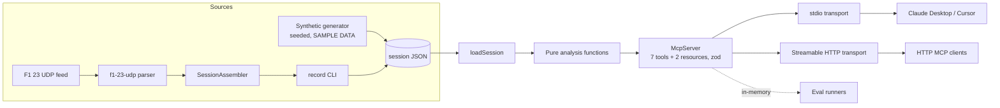

# f1-telemetry-mcp

An [MCP](https://modelcontextprotocol.io) server that gives AI assistants (Claude Desktop, Cursor, any MCP client) structured access to racing-game telemetry: lap and sector times, lap comparisons, braking zones, tyre wear and raw car telemetry.

It ships with a bundled **synthetic SAMPLE DATA session** (fictional driver and circuit) so it works out of the box, and can ingest a live **F1 23 UDP** telemetry feed via [`f1-23-udp`](https://github.com/raweceek-temeletry/f1-23-udp).

> **Not affiliated with Formula 1.** This is an independent hobby project. It is not associated with, endorsed by, or connected to Formula 1, the FIA, EA Sports or Codemasters. "F1" and related marks belong to their owners. The bundled data is synthetic.

## Quickstart

Requires Node.js 22+.

```bash
npm install
npm run build
npm start                 # stdio transport (what desktop MCP clients use)
npm start -- --http       # Streamable HTTP on http://127.0.0.1:3333/mcp
```

HTTP options: `--port` / `PORT`, `--host` / `HOST`, or `MCP_TRANSPORT=http`. It binds to localhost by default and has no auth, so don't expose it publicly as-is.

To load your own session file instead of the sample, set `F1_SESSION_FILE=/path/to/session.json`.

### Claude Desktop

Add this to `claude_desktop_config.json`:

```json
{
  "mcpServers": {
    "f1-telemetry": {
      "command": "node",
      "args": ["/absolute/path/to/f1-telemetry-mcp/dist/index.js"]
    }
  }
}
```

### Cursor

Add this to `.cursor/mcp.json` in your project, or to `~/.cursor/mcp.json`:

```json
{
  "mcpServers": {
    "f1-telemetry": {
      "command": "node",
      "args": ["/absolute/path/to/f1-telemetry-mcp/dist/index.js"]
    }
  }
}
```

Or point it at the HTTP transport: `{ "mcpServers": { "f1-telemetry": { "url": "http://127.0.0.1:3333/mcp" } } }`.

To load a recorded session, add `"env": { "F1_SESSION_FILE": "/path/to/session.json" }`.

### Recording a live session (F1 23)

Turn on UDP telemetry in the game (port 20777, format 2023), then run:

```bash
npm run record -- --out my-session.json --laps 5 --driver "Me" --circuit "Monza"
F1_SESSION_FILE=my-session.json npm start
```

Recording stops after `--laps` completed laps or when you press Ctrl+C. The adapter reads lap data, car telemetry, car damage (tyre wear) and car status (visual tyre compound) packets for the player car.

## Tools

| Tool | What it returns |
|---|---|
| `get_session_summary` | Driver, circuit, lap count, fastest lap, top speed, final tyre wear |
| `get_lap_times` | Lap and sector times for every lap |
| `compare_laps` | Total and per-sector delta between two laps, plus time delta by distance |
| `get_fastest_sector` | Fastest time for a sector, plus the theoretical best lap |
| `find_braking_points` | Braking zones on a lap: start/end distance, entry and minimum speed |
| `get_tyre_wear` | Wear (%) per corner per lap and average wear rate |
| `get_car_telemetry` | Speed/throttle/brake/gear/RPM samples for a distance range, downsampled |

Resources: `f1://session/summary` and `f1://session/laps/{lapNumber}`. Inputs are validated with zod. Domain errors, like a lap that doesn't exist, come back as MCP tool errors rather than protocol failures.

## Evals

`evals/cases.json` has 33 natural-language questions about the sample session. Each one lists the tool that should answer it, the JSON path to read and the expected value, with an optional numeric tolerance.

- **Deterministic** (`npm run eval`, runs in CI): calls the expected tool through a real in-memory MCP client and checks the answer. This tests the server and analysis code, not an LLM.
- **Agent** (`npm run eval:agent`, optional): an LLM gets the questions plus the MCP tool list, picks and calls tools itself, and answers in JSON. Answers are scored with the same matcher, and pass rate, latency and tool calls are recorded. It needs `ANTHROPIC_API_KEY` or `OPENAI_API_KEY` (`EVAL_MODEL` overrides the model), and skips if neither is set.
- Expected values come from the seeded sample generator. After changing the generator, run `npm run generate:sample && npx tsx evals/update-expected.ts` and review the diff by hand.

Reports are written to `evals/report.md` and `evals/report.json`.

| Mode | Cases | Passed | Notes |
|---|---|---|---|
| Deterministic | 33 | 33 (100%) | sub-millisecond per call, in-memory transport |
| Agent | 33 | not run yet | needs an API key; run it locally to fill this in |

Cases per tool: session summary 10, lap times 5, compare laps 5, braking points 5, fastest sector 4, tyre wear 4. `get_car_telemetry` is covered by unit tests only.

## Architecture



## Development

```bash
npm run lint && npm run typecheck && npm test && npm run eval
```

GitHub Actions runs the same steps plus a build on every push and pull request.

## How this was built

I built this with an agentic AI coding workflow under human review. I set the scope, the domain model and the constraints: synthetic data only, no real driver or team names, evals before polish. An AI coding agent then worked in small, separately committed steps (scaffold, ingest adapter, generator, analysis, server, tests, evals, transports, CI, docs), and lint, typecheck, unit tests and the eval suite had to pass at each step. I reviewed every change before it landed, including checking that the sample data really exercises the analysis (for example, sector bests come from different laps, so the theoretical best is faster than the fastest lap).

## License

MIT
